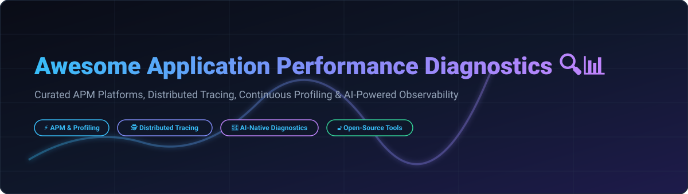

# Awesome-Application-Performance-Diagnostics 🔍📊

  

  
  
  
  
  

---

## 🌟 Top Application Performance Diagnostics Ecosystem

**Curated Directory of Enterprise SaaS APM Platforms & Open-Source Performance Diagnostics Tools** 🚀  
*Focused on Distributed Tracing, Continuous Profiling, eBPF Telemetry, Root Cause Analysis, Real User Monitoring (RUM), Error Tracking & OpenTelemetry Observability* 📊

**Last updated: October 2026** 📅

---

### 📌 Overview & SEO Summary 🌐

Welcome to the definitive, high-authority curated directory of **application performance diagnostics platforms**, **open-source APM solutions**, and **distributed tracing frameworks**. Whether you are evaluating commercial APM tools (such as *Datadog APM*, *Dynatrace*, *IBM Instana*, and *Salesforce Scale Center*), or deploying cost-effective open-source alternatives (like *Netdata*, *SigNoz*, *Apache SkyWalking*, *Jaeger*, and *OpenObserve*), this list provides comprehensive technical insights, pricing breakdowns, free tier quotas, and corporate valuations.

#### 🗝️ Key Market Trends & Innovations (2026):
- **Salesforce Scale Center GA**: Fully accessible across Enterprise, Unlimited, and Performance editions, providing near real-time org telemetry, Lightning Experience Insights (EPT metric), and automated performance bottleneck analysis ⚡.
- **AI-Driven & MCP Integration**: Platforms like **Honeycomb** feature native MCP (Model Context Protocol) integration for AI coding agents (Cursor, Claude Code), automated chain-of-thought incident investigation, and root cause anomaly detection 🤖.
- **eBPF-Powered Zero Instrumentation**: Open-source tools such as **Pixie**, **Parca**, and **Coroot** utilize eBPF kernel probes for real-time latency monitoring, memory profiling, and network tracing without code modifications 🐝.
- **OpenTelemetry Standard Consolidation**: Native support for **OTel** spans, metrics, and logs has become standard across both enterprise SaaS platforms and ClickHouse-backed open-source engines 🔭.

---

## 📑 Table of Contents 🧭

- [🏢 SaaS & Commercial Platforms](#-saas--commercial-platforms)
- [🔓 Open-Source GitHub Projects](#-open-source-github-projects)
- [🛠️ How to Contribute](#%EF%B8%8F-how-to-contribute)
- [🤝 Support & Sponsorship](#-support--sponsorship)
- [⚠️ Disclaimer](#%EF%B8%8F-disclaimer)
- [📊 Star History](#star-history)

---

## 🏢 SaaS / Commercial Platforms 🏬

📈 **Market Overview & Industry Structure:**  
The global **Application Performance Monitoring (APM) & Observability market** is estimated at **~$7.8 Billion in 2026** (projected to reach **$16.2 Billion by 2030** at a 13.5% CAGR). The market is **moderately fragmented**: enterprise software giants (Salesforce, IBM, SAP) dominate ecosystem-native telemetry, while specialized APM pioneers (Datadog, Dynatrace, New Relic) and innovative developer-focused platforms (Sentry, Honeycomb, Coralogix) aggressively capture high-cardinality cloud-native workloads.

*Sorted by Company Size / Valuation / Market Cap (Descending)* 📊

| SaaS / Commercial Platform | Company / Owner | Company Size (Valuation / Market Cap) 💰 | Standard Edition Starting Price 🏷️ | Free Tier / Free Trial Limits 🎁 | Core Diagnostics Capabilities & Features 🔍 |
| :--- | :--- | :--- | :--- | :--- | :--- |
| **[Salesforce Scale Center](https://help.salesforce.com/s/articleView?id=xcloud.scale_center_overview.htm&type=5)** ☁️ | Salesforce, Inc. | **~$250 Billion** (Market Cap) | **$0/month** (Included in Enterprise & Unlimited editions) | **Free forever with Salesforce subscription** (3 on-demand scale reports/week per org) | **Salesforce-native APM & telemetry** — Real-time org health, Experienced Page Time (EPT) insights, database query analysis, and peak usage diagnostics ⚡. |
| **[IBM Instana APM](https://www.ibm.com/products/instana)** ⚡ | IBM Corp. | **~$200 Billion** (Market Cap) | **$75/host/month** (Billed annually) | **14-day full-feature free trial** (Unlimited hosts during trial period) | **1-second granular automated APM** — Auto-discovery across 300+ stacks, generative AI root cause investigation, and AI gateway tracing 🤖. |
| **[SAP Cloud ALM](https://help.sap.com/docs/cloud-alm/applicationhelp/requests)** 🟢 | SAP SE | **~$200 Billion** (Market Cap) | **$0/month** (Included in SAP Enterprise Support) | **Free for all SAP Enterprise Support & Cloud clients** (Includes 8 GB telemetry storage per tenant) | **SAP-native Real User Monitoring** — ML-driven change-point detection, request bottleneck analysis, and end-to-end user transaction correlation 📊. |
| **[Datadog APM](https://www.datadoghq.com/product/apm/)** 🐶 | Datadog, Inc. | **~$40 Billion** (Market Cap) | **$31/host/month** (Pro APM Plan) | **14-day full-feature free trial** (Up to 5 hosts supported) | **Full-stack cloud observability** — Distributed tracing, continuous code profiling, Watchdog AI anomaly detection, and 600+ integrations 🐕. |
| **[Dynatrace](https://www.dynatrace.com/)** 🔮 | Dynatrace, Inc. | **~$15 Billion** (Market Cap) | **$0.04/hour per host** (~$28.80/host/month) | **15-day free trial** (Includes 1,000 host-hours free credits) | **Causal AI diagnostics engine** — Davis AI topology correlation, PurePath un-sampled code tracing, and automated fault impact analysis 🧠. |
| **[New Relic](https://newrelic.com/)** 🚀 | New Relic (TPG / Francisco Partners) | **~$6.5 Billion** (Acquired Valuation) | **$99/user/month** (Standard edition full user) | **Free Forever Plan: 100 GB/month data ingest free** (1 full user included) | **All-in-one consumption-based APM** — Infinite Tracing tail sampling, vulnerability management, and 700+ turnkey integrations 📉. |
| **[Sentry](https://sentry.io/)** 🎯 | Functional Software, Inc. | **~$3.0 Billion** (Valuation) | **$26/month** (Team Tier billed annually) | **Free Developer Plan: 5,000 errors & 10,000 transactions/month** | **Developer-centric error & performance tracking** — Session replay, stacktrace latency correlation, and threshold-free anomaly alerts 🎯. |
| **[Coralogix](https://coralogix.com/)** 🔵 | Coralogix Ltd. | **~$1.0 Billion** (Valuation) | **$0.20/GB ingested** (Compliance & Archive Tier) | **Free Forever Plan: 1 GB/day ingest & 14-day retention** | **Gartner Leader streaming-first APM** — In-stream telemetry processing, Olly AI assistant, MCP/CLI interfaces, and zero-indexing cost savings 🌊. |
| **[Honeycomb](https://www.honeycomb.io/)** 🍯 | Honeycomb.io, Inc. | **~$450 Million** (Valuation) | **$3.00 per million events** (Pro Tier) | **Free Forever Plan: 20 Million events/month** (Unlimited team members) | **AI-native high-cardinality observability** — BubbleUp multi-dimensional analysis, MCP skills for Claude Code & Cursor, and Slackbot AI 🤖. |
| **[Raygun](https://raygun.com/)** 🟠 | Mindscape Ltd. | **~$50 Million** (Valuation) | **$80/month** (APM Tier for 100K traces) | **14-day full-feature free trial** (10,000 test events included) | **Digital Experience & APM diagnostics** — Server-side execution tracing, real user monitoring (RUM), and real-time error dashboards 💻. |

---

## 🔓 Open-Source GitHub Projects 🌾

*Sorted by GitHub Stars_Counts (Descending)* 🌟

- **[Netdata](https://github.com/netdata/netdata)**   
  **Real-time infrastructure & application performance monitoring**, GPL-3.0 licensed. **73K+ GitHub_Stars** — Per-second telemetry collection, low latency metrics visualization, ML anomaly detection, and zero-configuration auto-discovery for Linux, Docker, and Kubernetes ⚡.

- **[Apache SkyWalking](https://github.com/apache/skywalking)**   
  **Application Performance Monitor & Observability platform**, Apache-2.0 licensed. **24.5K+ GitHub_Stars** — CNCF Graduated project supporting microservices tracing, service mesh telemetry, eBPF continuous profiling, and log aggregation 🌌.

- **[SigNoz](https://github.com/SigNoz/signoz)**   
  **Open-source Datadog alternative powered by OpenTelemetry**, Apache-2.0 licensed. **22.5K+ GitHub_Stars** — Unified APM metrics, traces, and logs backed by ClickHouse for ultra-fast high-cardinality debugging 📊.

- **[Jaeger](https://github.com/jaegertracing/jaeger)**   
  **End-to-end distributed tracing platform created by Uber**, Apache-2.0 licensed. **21.5K+ GitHub_Stars** — CNCF Graduated standard for tracking complex transaction flows, dependency graph analysis, and root cause diagnostics 🕵️.

- **[OpenObserve](https://github.com/openobserve/openobserve)**   
  **Cloud-native observability platform built in Rust**, Apache-2.0 licensed. **16.5K+ GitHub_Stars** — High-performance logs, metrics, traces, and RUM engine achieving up to 140x lower storage costs than traditional search indices 🌊.

- **[Pinpoint](https://github.com/pinpoint-apm/pinpoint)**   
  **APM for large-scale distributed Java/PHP/Python architectures**, Apache-2.0 licensed. **13.8K+ GitHub_Stars** — Real-time transaction map, active thread count monitoring, and bytecode instrumentation for microservice topology 📍.

- **[OpenTelemetry Collector](https://github.com/open-telemetry/opentelemetry-collector)**   
  **Vendor-neutral telemetry processing engine**, Apache-2.0 licensed. **13.2K+ GitHub_Stars** — CNCF core telemetry agent for receiving, transforming, filtering, and exporting traces, metrics, and logs across vendor backends 🔭.

- **[Grafana Pyroscope](https://github.com/grafana/pyroscope)**   
  **Continuous profiling platform for production code**, AGPL-3.0 licensed. **9.2K+ GitHub_Stars** — Minimal overhead CPU/memory flame graph profiler integrating seamlessly with Grafana dashboards ────────🔥.

- **[Grafana Tempo](https://github.com/grafana/tempo)**   
  **High-scale, cost-effective distributed tracing backend**, AGPL-3.0 licensed. **7.8K+ GitHub_Stars** — Object-storage native tracing database using TraceQL query engine for massive span volume 📈.

- **[Pixie](https://github.com/pixie-io/pixie)**   
  **eBPF-powered no-instrumentation Kubernetes observability**, Apache-2.0 licensed. **6.8K+ GitHub_Stars** — CNCF Sandbox project capturing network flows, application latency, and flame graphs instantly without code edits 🔮.

- **[Parca](https://github.com/parca-dev/parca)**   
  **Continuous profiling for application & infrastructure performance**, Apache-2.0 licensed. **4.6K+ GitHub_Stars** — eBPF & DWARF debug-info based CPU and memory continuous profiler identifying resource bottlenecks 🧬.

- **[Coroot](https://github.com/coroot/coroot)**   
  **Zero-instrumentation APM powered by eBPF**, Apache-2.0 licensed. **4.2K+ GitHub_Stars** — Autonomous root cause identification, network map visualization, and continuous performance telemetry 🎯.

- **[Uptrace](https://github.com/uptrace/uptrace)**   
  **OpenSource APM tool using OpenTelemetry & ClickHouse**, BSD-2-Clause licensed. **3.8K+ GitHub_Stars** — High-efficiency trace visualization, SQL-like querying, and distributed span aggregation 📉.

- **[Hypertrace](https://github.com/hypertrace/hypertrace)**   
  **Distributed tracing & application observability platform**, Apache-2.0 licensed. **1.2K+ GitHub_Stars** — Real-time payload inspection, API performance tracking, and service topology mapping 🔗.

- **[Guider](https://github.com/iipeace/guider)**   
  **Unified Linux & Android performance diagnostics analyzer**, GPL-2.0 licensed. **1.1K+ GitHub_Stars** — System-wide microsecond-level thread execution profiling, flame graphs, and kernel event logging 🐧.

---

## 🛠️ How to Contribute 🤝

Contributions are actively welcomed! Follow these guidelines to suggest new performance diagnostic tools or update existing entries:

1. 🍴 **Fork** this repository.
2. 📝 **Edit `README.md`**, preserving the descending order and markdown table formatting.
3. 🔗 Include official links, accurate company size/valuation, specific starting prices, exact free tier limits, and GitHub Stars_Badges.
4. 🚀 Open a **Pull Request** detailing your additions!

---

## 🤝 Support & Sponsorship ☕

Thank you for exploring and using this Application Performance Diagnostics ecosystem guide! Your support helps keep this directory updated with the latest APM, profiling, and observability technologies. If you find this repository valuable:

- ⭐ **Star** this repository on GitHub to help increase its visibility!
- 🔀 **Fork & Share** with your fellow DevOps engineers, SREs, and software architects.
- ☕ **Buy Me a Coffee**: Consider sponsoring and supporting ongoing open-source curation via the [GitHub Sponsor Dashboard](https://github.com/sponsors/ishandutta2007).

---

## ⚠️ Disclaimer 📜

- Community-curated resource for informational purposes — not an explicit endorsement. ℹ️
- Pricing data and free tier quotas represent starting standard plans as of October 2026. 📅
- Open-source tools require self-hosted infrastructure (ClickHouse, Kubernetes, eBPF support). Test telemetry collection in a staging environment before production deployment. 🔍

---

##  Star History

---

  <b>Made with ❤️ for SREs, DevOps Engineers, and Performance Optimization Advocates worldwide.</b>

